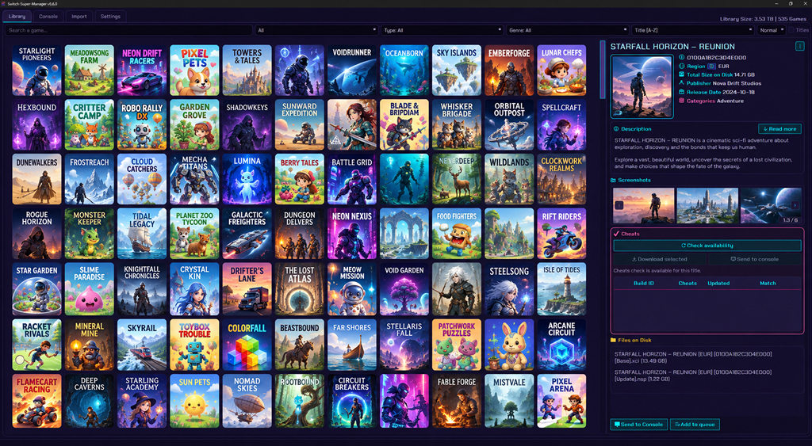
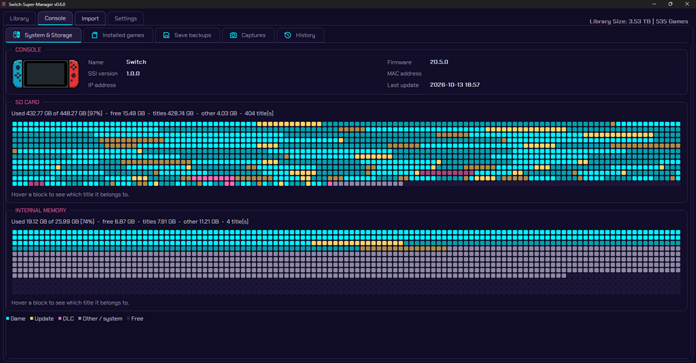
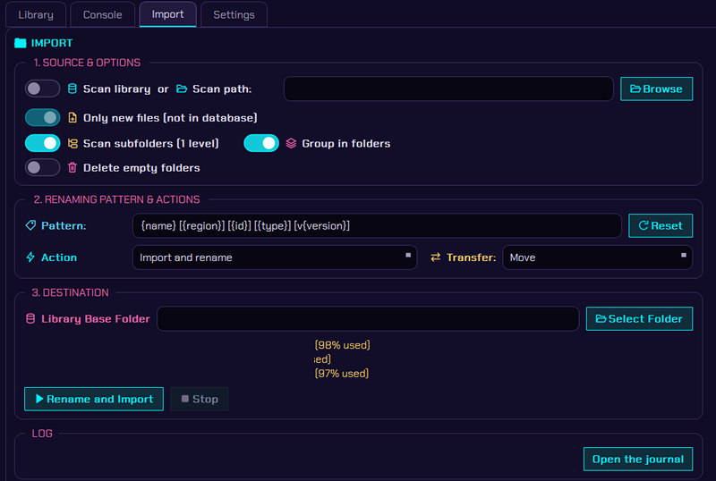

# Switch-Super-Manager

Desktop manager for your Nintendo Switch homebrew library, and the companion of **[Switch-Super-Installer](https://github.com/Ch1nguya/Switch-Super-Installer)** (SSI), a homebrew that installs, backs up and manages content on the console over your local network.

> **Status:** v0.6.5. The application source is **closed** until v1.0 (SSI is open source, GPL v3). This repository holds the
> public kit: documentation, theme kit, utilities and links to the binaries (see [Releases](https://github.com/Ch1nguya/Switch-Super-Manager/releases)).

| | |
|---|---|
|  |  |
| *Your library, with covers, details and cheats* | *The console tab: what is installed and the free space* |

## Features

- Browse your library with covers, descriptions, screenshots and the firmware each game needs.
- Import and organise your dumps into one or several library folders, with the free space of each shown.
- Send games, updates and DLC to the console over your network or USB, with a queue, progress, history and a space check.
- See what is installed on the console and its free space, uninstall remotely and back up your saves.
- Copy the screenshots and videos from the console album to your PC.
- Send cheats straight to the console.
- Spot duplicates, regroup files that belong together and review the library against the latest TitleDB.
- Export your library to a PDF with covers or to a CSV spreadsheet, and see the files SSM could not recognise.
- Two built-in themes, and your own (see [themes/](themes/README.md)).
- Available in English, French, Spanish, German, Italian, Brazilian Portuguese, Japanese, Simplified Chinese and Korean (the new translations are machine-made: corrections are welcome).
- A start-up assistant on the first launch: language, keys, library folder and first scan.
- A statistics window with pie charts and the free space of each library folder, filters by location, and a pie chart view of the console storage.
- A notice when a new version is out (SSM only opens the release page; it never installs anything).

See [docs/features.md](docs/features.md) for details.

## Support the project

Switch-Super-Manager and Switch-Super-Installer are free and made on my spare time. If they are useful to you and you feel like it, you can **buy a retro game for my collection** on Ko-fi. It is never required, and always appreciated. Thank you!

  

## Getting started

[docs/getting-started.md](docs/getting-started.md)

## Documentation

| Topic | File |
|---|---|
| Getting started | [docs/getting-started.md](docs/getting-started.md) |
| Features | [docs/features.md](docs/features.md) |
| Network and firewall | [docs/network.md](docs/network.md) |
| SSI HTTP API (console, port 2003) | [docs/ssi-api.md](docs/ssi-api.md) |
| SSM HTTP API (PC, port 2002) | [docs/ssm-api.md](docs/ssm-api.md) |
| Console inventory format | [docs/console-inventory.md](docs/console-inventory.md) |
| SSM themes | [themes/README.md](themes/README.md) |
| SSI themes | [docs/ssi-themes.md](docs/ssi-themes.md) |
| FAQ | [docs/faq.md](docs/faq.md) |

## Binaries

Binaries are published only through GitHub Releases, with a `SHA256SUMS` file. See [RELEASING.md](RELEASING.md).
**No keys are ever distributed**: you must supply your own `prod.keys`, dumped from your own console.

## Utilities

Community utilities (Python / Rust) will live in [tools/](tools/README.md).

## Licenses and credits

| Component | License |
|---|---|
| **Switch-Super-Manager** (SSM, PC application) | [PolyForm Noncommercial 1.0.0](LICENSE): free for personal, non-commercial use. Source closed until v1.0. |
| **Switch-Super-Installer** (SSI, Switch homebrew) | GPL v3, open source: [Ch1nguya/Switch-Super-Installer](https://github.com/Ch1nguya/Switch-Super-Installer) |
| This repository (documentation, themes, tools) | [PolyForm Noncommercial 1.0.0](LICENSE), unless a file says otherwise |

SSI is built on TinWoo by MrDude, which merges Tinleaf and [Awoo Installer](https://github.com/Huntereb/Awoo-Installer) by Huntereb,
itself based on [Adubbz's Tinfoil](https://github.com/Adubbz/Tinfoil) (MIT) and using [XorTroll's Plutonium](https://github.com/XorTroll/Plutonium).
Thanks to MrDude, Huntereb, Behemoth, XorTroll, BlaWar, DarkMatterCore and all upstream contributors.

Not affiliated with Nintendo. Use only with games you own; no keys or games are provided.
